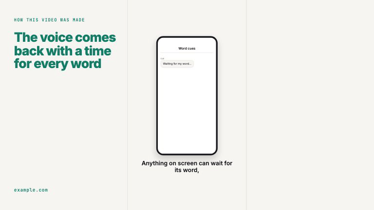
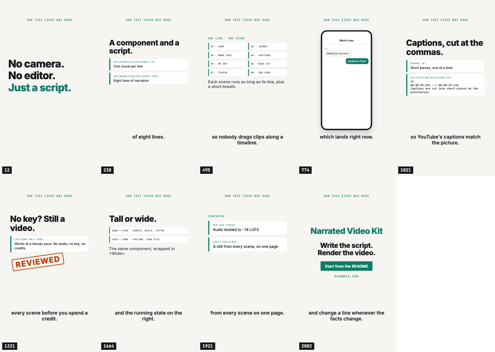

# Narrated Video Kit: Remotion + ElevenLabs explainer videos, timed word by word

Write a script and get a narrated explainer video, built in code with Remotion and ElevenLabs: every scene timed to the voice word by word, in vertical and 16:9, with burned-in captions, an SRT file, leveled audio, thumbnails and a one-page review sheet. Captions-only mode lays out the whole video with no API key, before any voice is generated.

The kit's code is Apache-2.0. It runs on [Remotion](https://www.remotion.dev), which is source-available and free only for individuals and teams of up to 3 people ([details below](#remotions-licence)).



The example video explains the kit itself. Above is its wide cut, rendered by the kit. Below is its review sheet: the hook, then one still near the end of each scene.



## Quick start

```bash
git clone https://github.com/nussbeck-labs/narrated-video-kit.git && cd narrated-video-kit
npm ci
npm run make -- explainer
```

That renders `out/explainer.mp4` (1080x1920, 73 seconds) and `out/explainer.srt`. No API key is needed. The example has no voice: it ships with captions-only timing, so it plays silent apart from two sound effects. On the first render Remotion downloads Chrome Headless Shell, which it uses to draw frames: 147 MB on Apple silicon or 108 MB on Linux x64, about 460 MB once unpacked into `node_modules/.remotion`.

`npm run make -- explainer-wide` renders the 1920x1080 cut. `npm run studio` opens the project in Remotion Studio to preview and edit it.

**Requirements.** Node 22.13+ or 24+ (20.19+ also works, but Node 20 reached end of life in April 2026). Tested on macOS with Apple silicon on 2026-11-17; the CI workflow runs Ubuntu with Node 22 and 24. Linux needs [Chrome's system libraries](https://www.remotion.dev/docs/miscellaneous/linux-dependencies). Windows is not tested: the scripts avoid shell-specific paths, but nobody has run them there yet.

## Two kinds of id

- A **video id** names a script: `src/narration/<id>.json`, with its timing in `public/narration/<id>/timing.json`. `narrate` and `srt` take a video id.
- A **composition id** names something Remotion can render: the video id for the vertical cut, `<id>-wide` for the 16:9 cut, `sheet-<id>` for its review sheet, and `thumb-<id>-a` for a thumbnail. `render`, `still` and `make` take a composition id; `make` works out the video id from it. `npx remotion compositions src/index.ts` lists them all.

## How it works

1. **A script.** `src/narration/<id>.json` holds the narration, one paragraph per scene, plus an ElevenLabs voice ID once you want a voice.
2. **Timing.** `npm run narrate -- <id>` voices each line through ElevenLabs' with-timestamps endpoint. Each line is saved as `<hash>.mp3` with its word timings in `<hash>.json`, where the hash covers the model, the voice and the line's text. A line is therefore reused wherever it moves: after an edit, an insert or a reorder, only new or changed lines are voiced. Neighbouring lines are sent as context for a smoother read but are not part of the hash, so editing one line does not re-voice the lines around it. Finished lines are kept if a run fails, and `timing.json` is written only once every line is ready. Old lines stay cached so an undo costs nothing; add `--prune` to delete the ones the script no longer uses.
3. **Captions-only mode.** `npm run narrate -- <id> --captions-only` writes the timing with no key and no audio, spreading the words at 2.8 per second. Lay out and review every scene first, then voice it once.
4. **Scenes and cues.** `timeline(lines)` places the scenes back to back, each as long as its line plus a 0.35-second breath. `cue(scene, 'word')` returns the frame where that word is spoken, and `cue(scene, 'word', 1)` its second time. Anything can wait for its word: `ramp(frame, cue(2, 'now'), cue(2, 'now') + 10)`. If an edit removes the word, `cue` throws and quotes the line, so the render stops instead of drifting. Cues run while a scene renders, so a stale cue breaks only its own video. A missing or empty `timing.json` is different: `src/Root.tsx` imports every video's timing, so it stops all compositions from loading until `npm run narrate -- <id> --captions-only` restores it.
5. **The video.** `NarratedVideo` takes the scenes and one visual per scene. It adds the opening hook, the narration audio, the header and the captions, cut into short chunks at punctuation and dashes.
6. **The wide cut.** `<Wide of={Video} />` renders the same component at 1920x1080. The vertical frame sits in the middle, the scene's headline on the left, and an `aside` panel on the right that carries state from scene to scene. The end card holds 8 seconds so a YouTube end screen fits.
7. **Finishing.** `npm run make` renders, then levels narrated audio to -14 LUFS with a -2 dBTP peak ceiling in two loudnorm passes, measures the result and prints it. A captions-only video keeps its sound effects as rendered, because leveling them alone would make them far too loud. The SRT is cut into the same chunks as the burned-in captions. It differs in two small ways: it includes the words spoken under the opening hook, and its last cue ends with the narration while the end card stays up.

| Command | What it does |
| --- | --- |
| `npm run make -- <composition>` | Render, level and caption: `out/<composition>.mp4` and `.srt` |
| `npm run studio` | Preview and edit in the browser |
| `npm run narrate -- <video> --captions-only` | Timing without a voice or a key |
| `npm run narrate -- <video>` | Voice the script with ElevenLabs (needs a key and a `"voice"`); add `--prune` to delete voiced lines no longer used |
| `npm run narrate -- voices` | List the voices your key can use |
| `npm run narrate -- audition <voice_id>...` | One test sentence per voice, in `out/auditions` |
| `npm run still -- sheet-<video> out/sheet.png` | Review sheet (`sheet-<video>-wide` for the wide cut) |
| `npm run still -- thumb-<video>-a out/thumb.jpg --image-format=jpeg` | Thumbnail |
| `npm run render -- <composition> out/raw.mp4` | Render only, with any [Remotion render option](https://www.remotion.dev/docs/cli/render) |
| `npm run finish -- <in.mp4> <out.mp4> --video <video>` | Level a render's narration and print the measured loudness; a captions-only video is left as rendered. `--force` instead of `--video` levels any file without the check |
| `npm run srt -- <video> <file.srt>` | Write the captions file on its own |
| `npm run check` | Lint, typecheck, tests with coverage, bundle and licence check |

Arguments and `--flags` can come in any order, after the `--` that separates them from npm's own options: `npm run narrate -- explainer --captions-only`. A flag a command does not take is an error, and so is a kit flag npm took for itself because it came before `--`.

Ctrl-C stops any command, Studio included. npm passes SIGINT and SIGTERM on to the kit, which passes them to Remotion. npm does not pass on SIGHUP, but closing the terminal signals every process started from it, so Studio stops then too.

## Add a voice

1. Create a key at [elevenlabs.io/app/settings/api-keys](https://elevenlabs.io/app/settings/api-keys). Copy `.env.elevenlabs.example` to `.env.elevenlabs` (gitignored) and put the key there, or export `ELEVENLABS_API_KEY` in your shell. The kit reads it from nowhere else.
2. Run `npm run narrate -- voices` and pick a voice. `npm run narrate -- audition <voice_id> <voice_id>` reads one sentence in each, so you can compare them.
3. Add `"voice": "<voice_id>"` to the script, then run `npm run narrate -- explainer` and `npm run make -- explainer`.

**Why not `.env`?** By default Remotion copies every variable from `.env` (or `.env.local` when there is no `.env`) into the Studio page and every render, reloads that file while Studio runs, and Studio is reachable from other devices on your network. `remotion.config.ts`, which Remotion runs at the start of every command (plain `npx remotion …` too), points Remotion at an empty env file instead. It creates that file for each run in a new private directory in the system temp folder: the directory is readable only by your user, and it is removed when the command exits (including Ctrl-C, SIGTERM and SIGHUP). So `.env`, `.env.local` and other users on the machine cannot put variables on the page; a program running as you could still write to that file while Studio runs. One route stays open by Remotion's design: **every variable whose name starts with `REMOTION_` is public**, whether it comes from your shell or from `.env` (Remotion's CLI loads `.env` at start). `remotion.config.ts` refuses to start when such a name looks like a secret (it contains KEY, TOKEN, SECRET, PASSWORD, CREDENTIAL, AUTH or PRIVATE); any other `REMOTION_*` value should be something you are happy to publish. Remotion commands also refuse to start if `remotion.config.ts` is missing. CI runs `scripts/studio-check.sh`, which starts Studio with a test key in the shell, `.env.elevenlabs` and `.env`, then writes it into `.env` and `.env.local` (both `=` and `:` forms) while Studio runs, and fails if the key shows up in the page or its scripts. It also checks that a secret-like `REMOTION_*` variable stops Studio from starting.

The example ships without a voice on purpose. ElevenLabs says its default voices expire on December 31, 2026 ([voices docs](https://elevenlabs.io/docs/overview/capabilities/voices), checked 2026-11-17), and on that date every voice our test key listed was a premade (default) voice, so any ID shipped here would stop working. Pick one your account will keep.

The default model is `eleven_v4`; set `"model"` in a script to use another. The voiced path was run end to end on 2026-11-17: eight lines voiced in 29 seconds, a second run reused all eight, and the finished file measured -14.1 LUFS.

## Make your own video

1. Copy `src/narration/template.json` to `src/narration/my-video.json` and write your lines. Each one becomes a scene, so keep them to a sentence or two.
2. Run `npm run narrate -- my-video --captions-only`.
3. Copy `src/examples/Template.tsx` to `src/examples/MyVideo.tsx`. In the copy, point the timing import at `public/narration/my-video/timing.json`, set `dir="my-video"`, and rename the four exports: `Template` to `MyVideo`, `TemplateWide` to `MyVideoWide`, `TEMPLATE_FRAMES` to `MY_VIDEO_FRAMES` and `TEMPLATE_REVIEW` to `MY_VIDEO_REVIEW`. The template shows each line's first sentence as a headline, so it works for any number of lines.
4. Register it in `src/Root.tsx` the way the template is, as `my-video`, `my-video-wide` and `sheet-my-video`, using the new export names.
5. Run `npm run make -- my-video`. Then replace the template's visuals one scene at a time, using the parts in `src/parts.tsx` (`Stack`, `Big`, `Small`, `Eyebrow`, `Card`, `Chips`, `Phone`, `Thread`, `Stamp`, `Result`, `EndCard`) and `cue()`, as `src/examples/Explainer.tsx` does. Check your work with `npm run still -- sheet-my-video out/sheet.png`.
6. Restyle everything in `src/theme.ts`: colours, fonts, and the name, site and logo on the end card.

## With a coding agent

Nobody on our team edits video. A coding agent (we use Claude Code) does the steps above: it writes the lines in `src/narration/<id>.json`, builds each scene from the parts in `src/parts.tsx`, runs `npm run make`, and checks the review sheet (`npm run still -- sheet-<id> out/sheet.png`) instead of watching the render. Because every visual waits on `cue()`, an edit to one line can't quietly push the rest of the video out of sync: the render stops and quotes the line.

Two habits save time and credits:

- Lay out and review the whole video with `--captions-only` first, and voice it once at the end.
- Read the loudness numbers `npm run make` prints instead of playing the file.

## When something fails

Every script stops with `Error:`, what went wrong, and the next step. The common ones:

| Message starts with | Fix |
| --- | --- |
| `this kit needs Node 22.13+ or 24+` | Install a current Node from nodejs.org, then `npm ci` |
| `the dependencies are not installed` | Run `npm ci` |
| `REMOTION_..._KEY would be copied into the Studio page` | Remove that variable from your shell or `.env`, or rename it without the `REMOTION_` prefix |
| `ELEVENLABS_API_KEY is in .env` (or `.env.local`), `but the kit reads the key only from...` | Move that line to `.env.elevenlabs` |
| `remotion.config.ts is missing` | Restore it with `git checkout -- remotion.config.ts` |
| `ELEVENLABS_API_KEY is not set` | Add the key to `.env.elevenlabs`, or use `--captions-only` |
| `ElevenLabs rejected ELEVENLABS_API_KEY` | The key is wrong or revoked; create a new one at the link in the message |
| `... has no "voice"` | Add a voice ID from `npm run narrate -- voices` to the script |
| `There is no timing for "<id>"` | Run `npm run narrate -- <id> --captions-only` |
| `Remotion could not get Chrome Headless Shell` | The first render needs a connection; on Linux, install [these libraries](https://www.remotion.dev/docs/miscellaneous/linux-dependencies) |
| `The ffmpeg bundled with Remotion is missing` | Run `npm ci` again, without `--omit=optional` |
| `"<word>" is not spoken in line N` | A cue names a word the line no longer has; change the cue or re-run `narrate` |
| `npm took --captions-only as its own option` | Put `--` before the kit's arguments: `npm run narrate -- <id> --captions-only` |
| `finish needs --video <id>` | Name the video so finish can check for narration, or add `--force` |
| `Module not found: Error: Can't resolve '../../public/narration/<id>/timing.json'` | A video's timing file is missing, so no composition loads; run `npm run narrate -- <id> --captions-only` |
| `Error The narration timing has no lines.` | A video's timing file is empty, so no composition loads; run `npm run narrate -- <id> --captions-only` |

## Limits and costs

- **Rendering is local.** On an Apple M4 laptop, `npm run make -- explainer` takes about 31 seconds for the 73-second video and about 34 for its wide cut once Chrome is downloaded; a first run from a fresh clone took 40 to 60 seconds (measured 2026-11-17).
- **Voice costs are ElevenLabs'.** On API pay-as-you-go, `eleven_v4` costs $0.08 per 1,000 characters ([API pricing](https://elevenlabs.io/pricing/api), checked 2026-11-17); the example script is 1,007 characters, about $0.08. On subscription plans, the pricing FAQ counts text to speech at 1 credit per character, and the free plan includes 10,000 credits a month ([pricing](https://elevenlabs.io/pricing), checked 2026-11-17). The pricing page lists a commercial licence from the Starter plan up; check your plan before publishing voiced videos.
- **Cues and captions assume English-like text.** `cue()` matches words by their letters and digits, and captions break at Latin punctuation and dashes.
- **Fonts load from Google Fonts at render time** (Inter and JetBrains Mono, both SIL Open Font License), so renders need a connection.
- **ffmpeg ships with Remotion.** `narrate`, `finish` and `make` use it, so there is nothing else to install. Only `npm run sfx`, which rebuilds the six sound effects from plain tones, needs a system ffmpeg; the generated files are already in `public/sfx`.
- **No music is included.** Add a track you have the rights to with Remotion's `<Audio>`.

## Remotion's licence

This kit's own code is Apache-2.0. Remotion is not covered by that licence: its FAQ says it "is source-available software, but it is not open source software". You install it from npm under the Remotion License. As of 2026-11-17 ([FAQ](https://www.remotion.dev/docs/license/faq), [pricing](https://www.remotion.dev/docs/license/pricing)):

- **Free:** individuals, and companies or teams of up to 3 people, including commercial use. Non-profits and evaluation are also free.
- **Company License:** needed from 4 people up. Contractors who work on the project count toward the headcount. The licence is held by the entity that owns the IP of the Remotion project. If you build videos for a client and deliver only the MP4, your own headcount counts. If the client owns the project, theirs does as well.
- **Pricing:** $25 per seat per month for people who make videos, or $0.01 per render (minimum $100 a month) for automated rendering. Enterprise starts at $500 a month.
- **Remotion 5.0** is announced, not released, and comes with new terms. Re-read the FAQ when you upgrade.

ElevenLabs has its own terms for the voice audio.

## Licence

Apache-2.0 (see `LICENSE` and `NOTICE`). The `NOTICE` file must travel with copies and forks. Names and logos are not licensed (see `TRADEMARKS.md`). Contributions are welcome under the terms in `CONTRIBUTING.md`.

---

## Why it's free

Every video on our channel comes out of this engine, made by an agent with AI voices. We publish it because the code was never the scarce part. Knowing what a three-minute video should say to the person watching it still is. The code is free. The handoff is the work.

**GoodHandoff** builds and runs the automation that carries a home service job from the first call to the final payment, inside the company's own CRM, phone and texting tools: [goodhandoff.com](https://goodhandoff.com/?utm_source=github&utm_medium=readme&utm_campaign=narrated-video-kit&utm_content=footer).
